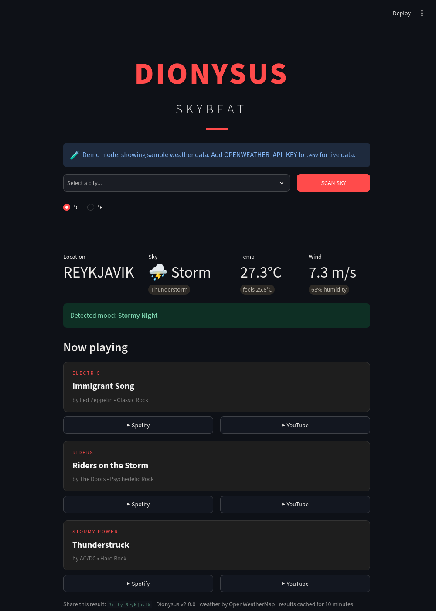
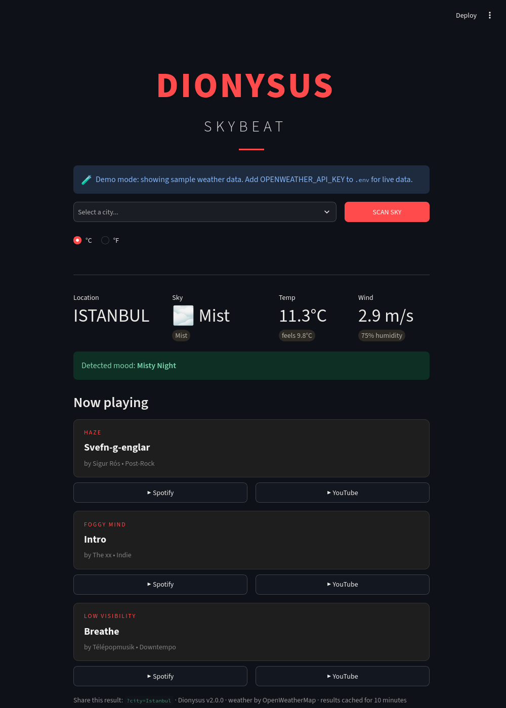
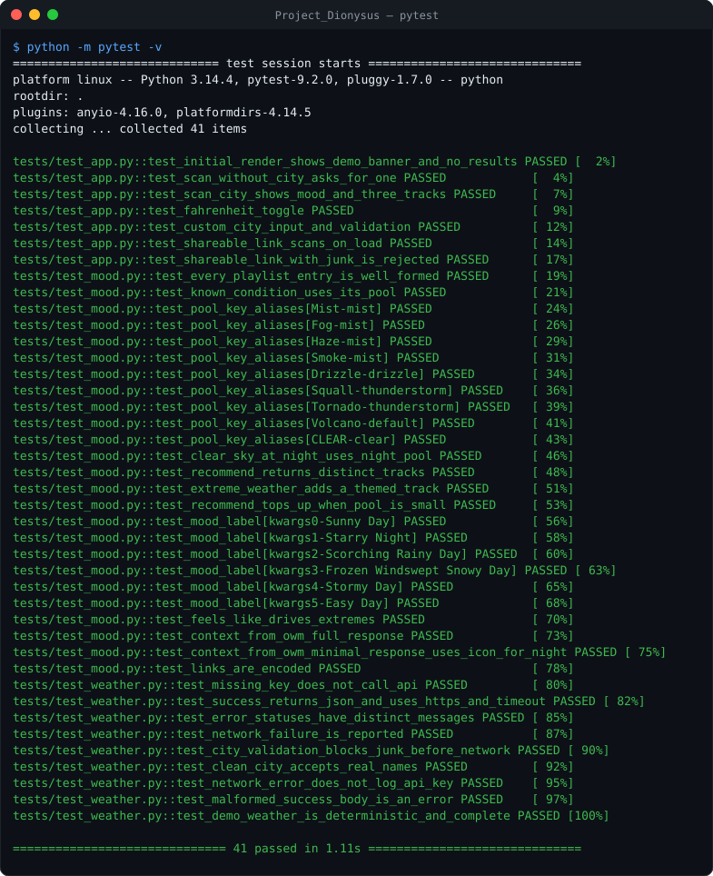
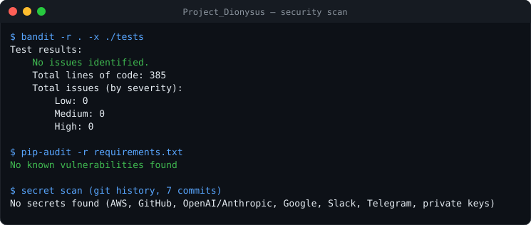

# Dionysus | Skybeat

> Weather-driven music: read the sky of any city, get a soundtrack that matches it.

[](https://github.com/fas0ftware/Project_Dionysus/actions/workflows/ci.yml)


**Dionysus** is a Streamlit app that fetches live weather from OpenWeatherMap and turns it into a mood and a three-track playlist. Version 2 reads more than the sky: **temperature (feels-like), wind and whether the sun is up in that city** all shape the result.

<p align="center">
  
  
</p>

<sub>Screenshots taken in demo mode (sample data), so they can be reproduced without an API key.</sub>

## ◼ Features

- **Live weather** from OpenWeatherMap over HTTPS, with a timeout and a clear message for every failure (missing/invalid key, unknown city, rate limit, network, malformed response).
- **Mood engine** – 12 song pools (clear day, starry night, clouds, mist, drizzle, rain, snow, storm, heatwave, freezing, windy, default) and a combined label such as *Frozen Windswept Snowy Day* or *Starry Night*.
- **Three-track playlist** per scan, no duplicates; extreme heat, cold or wind contributes a themed track.
- **Spotify and YouTube** buttons for every track (search links, so they never go stale).
- **°C / °F** toggle, feels-like temperature, humidity and wind.
- **Shareable links** – `?city=Tokyo&unit=F` scans straight away; the app updates the URL after every scan.
- **Demo mode** – runs without an API key using deterministic sample data (clearly labelled), great for trying it out.
- **Caching** – each city is cached for 10 minutes to protect your free API quota.
- **Secure by default** – input is validated before any request, every value shown in HTML is escaped, the API key is never logged (not even inside network error messages) and Streamlit's XSRF/CORS protection stays on.

## ◼ Quick start

```bash
git clone https://github.com/fas0ftware/Project_Dionysus.git
cd Project_Dionysus
python3 -m venv venv && source venv/bin/activate   # Windows: venv\Scripts\activate
pip install -r requirements.txt
streamlit run app.py                               # demo mode until you add a key
```

### Live data

Get a free key at [openweathermap.org/api](https://openweathermap.org/api), then:

```bash
cp .env.example .env      # Windows: copy .env.example .env
# edit .env:  OPENWEATHER_API_KEY=your-key
streamlit run app.py
```

On Streamlit Community Cloud put `OPENWEATHER_API_KEY` in the app's **Secrets** instead. Set `DIONYSUS_DEMO=1` to force demo mode even when a key is present. A brand-new key can take a while to activate (you will see a 401 message until then).

## ◼ How the mood is chosen

| Signal | Effect |
|---|---|
| Sky (`Clear`, `Clouds`, `Rain`, `Drizzle`, `Snow`, `Thunderstorm`, `Mist`/`Fog`/`Haze`/`Smoke`...) | Main song pool |
| Clear sky after sunset (city local time) | *Starry Night* pool instead of the sunny one |
| Feels-like ≥ 30 °C / ≤ −2 °C | *Scorching* / *Frozen* label + one heatwave / freezing track |
| Wind ≥ 10 m/s | *Windswept* label + one windy track |

The mapping lives in [`mood.py`](mood.py) and has no Streamlit or network dependency, so it is easy to reuse or extend with your own songs.

## ◼ Tests

41 tests: the mood engine, the OpenWeatherMap client (all mocked, no network) and **headless UI tests** that drive the real app with Streamlit's `AppTest` (scan, unit toggle, custom city, shareable links, input validation).

```bash
pip install -r requirements-dev.txt
python -m pytest -v
```



## ◼ Security

CI runs [bandit](https://github.com/PyCQA/bandit) and [pip-audit](https://github.com/pypa/pip-audit) on every push. Latest local scan (including a secret scan of the whole git history):



## ◼ Project structure

```
Project_Dionysus/
├── app.py                 # Streamlit UI
├── mood.py                # Mood engine and song pools
├── weather.py             # OpenWeatherMap client, input validation, demo data
├── .streamlit/config.toml # Dark theme, security settings
├── tests/                 # test_mood.py, test_weather.py, test_app.py (AppTest)
├── docs/                  # README images
└── .devcontainer/         # Codespaces / dev container
```

## ◼ Changelog

- **2.0.0** – Mood engine v2 (temperature, wind, day/night), 3-track playlists, YouTube links, °C/°F, shareable URLs, demo mode, caching, Streamlit Cloud secrets, input validation, API key never logged, HTML escaping, dark theme, XSRF/CORS protection kept on in the dev container, pytest + AppTest suite, CI security scans.
- **1.0.0** – Weather to single song suggestion.

## ◼ Notes

- The free OpenWeatherMap plan has request limits; results are cached for 10 minutes.
- Suggestions come from a hand-picked list, not from your listening history.

---

Part of the **FA Software** projects. Licensed under the [MIT License](LICENSE).
